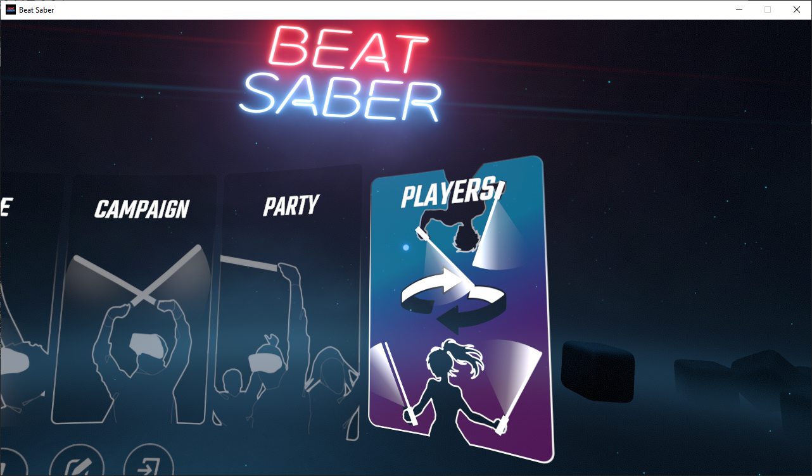
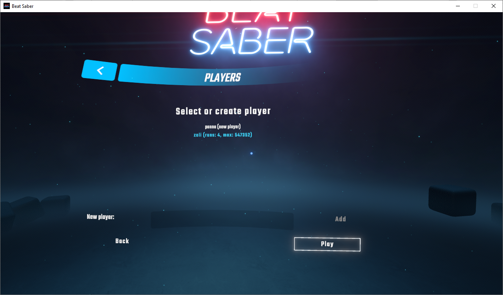
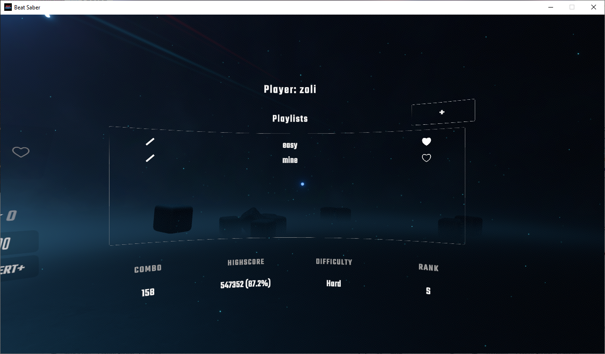

# Profiles

Profiles 0.9.3 is a BSIPA plugin for Beat Saber 1.46.0. It adds a `Players` button to the main menu and creates a mod-owned SQLite database, `ProfilesMod.sqlite3`, alongside the Beat Saber game instance. Initialization creates the schema and performs a write probe before making the database available; if that fails, the Players button is disabled, the cause is written to the BSIPA log, and (when the game exposes `HMUI.HoverHint`) the cause appears on hover.

## Disclaimer and development

This is an unofficial community mod, not affiliated with or endorsed by Beat Saber or its developers. It was developed iteratively with GitHub Copilot assistance, using C# and the .NET SDK, inspection of Beat Saber 1.46.0 managed assemblies with ILSpy, focused checks, logs, and player feedback. It uses BSIPA, Harmony, and System.Data.SQLite; those projects and Beat Saber remain subject to their own licenses.

The mod is provided as-is, without warranty. Back up your game and profile data before installing or updating it.

The source in this repository is licensed under the [MIT License](LICENSE).

## Database schema

The database contains `players`, `playlists`, `playlist_songs`, and `runs` tables. Generated row IDs use canonical UUIDv7 strings; `ProfileDatabase.NewId()` supplies them on .NET Framework 4.7.2, which does not provide a built-in UUIDv7 generator. `song_id` stores Beat Saber's `BeatmapKey.levelId` exactly, including the `custom_level_` prefix for custom songs. `playlist_songs` uses `(playlist_id, song_id)` as its composite key. Runs have a UUIDv7 `id` in addition to the requested fields so each run has a globally unique row identity.

`created` and `when` are stored as ISO 8601 text with an explicit UTC offset, suitable for round-tripping `DateTimeOffset` values (for example, `2026-11-15T21:32:04.5510000+00:00`). `modifiers` is JSON text and defaults to `{}`; `selected` is an integer boolean. Foreign keys cascade when a player or playlist is deleted, and partial unique indexes allow at most one selected player and one selected playlist per player.

`runs.combo` is a required integer: a negative value denotes max combo, with its absolute value giving the combo count; a positive value denotes less than max.

The three PNGs in `Resources` are embedded in `ProfilesMod.dll` and used at runtime for the button's normal, highlighted/pressed, and overlay artwork. The artwork fills the cloned image rectangles; the menu button's overall size and layout are unchanged.

## Player profiles



Open `Players` from the main menu to create or select a player. The selected name is highlighted; `Play` saves that selection and continues through the game's Solo flow. Players can be deleted only when they have no recorded runs. The player list scrolls when it contains more entries than fit on screen.



Each row shows the number of recorded runs and their maximum `points`, or `new player` when there are no runs. Both cleared and uncleared recorded runs are counted.

In profile Solo, the main title identifies the player, and the right screen shows their playlists. Use `+` to create a playlist and its edit control to rename or delete it; deletion requires confirmation. Select a playlist title to show its songs from the full available library, regardless of the current stock pack or filter; the title identifies the playlist and the category buttons and pack selector are hidden. Select it again to restore the stock song list and controls. The selection resets when leaving Solo, but remains active through gameplay and temporary subviews. The heart toggles the selected song in that playlist independently of other playlists. Playlists are per player, and hearts require a selected song. Normal Solo retains its stock leaderboard and filtering.



The profile statistics use the run with the highest `points` for the selected song (ties use the lowest run ID), whether cleared or failed. The rank is `-` for a failed run, even if a lower-point run was cleared. Values are white when a run exists; captions and missing values are gray. An index on `(player_id, song_id, points DESC, id)` supports this lookup.

Profile Solo records completed clears and failures for the player active when the attempt starts; practice, quits, and restarts are not recorded. `mode` is the beatmap characteristic's serialized name, `difficulty` is its serialized difficulty, `points` is the game's multiplied score before modifiers, and `score` is those points as a percentage of the full map's maximum multiplied score, rounded to one decimal and stored as `REAL`. `rank` is the game's rank name for a cleared run, or NULL for a failed run. A run with no positive maximum score cannot be recorded and is logged as an error. Existing databases require manual schema and data updates for `rank` and `score`; older `score` values were modifier-adjusted integers, not percentages, and cannot be converted without the missing map maximum. `modifiers` records every GameplayModifiers field as JSON (enum values are the game's numeric values). Full combo is encoded only for cleared runs; a zero full combo cannot be represented distinctly from zero by the signed combo encoding.

The picker is presented through Beat Saber's main flow coordinator. It clones the configured song-search input and uses the game's global VR keyboard when their required references are available. If no safe native input or text-entry screen is available, name entry is disabled and the picker reports that limitation; Profiles does not create its own keyboard or edit private input-field internals.

## Requirements

- A complete, 64-bit Beat Saber 1.46.0 installation.
- Windows PowerShell 5.1 or later.
- Internet access to download the pinned BSIPA release when the loader is not already compatible, and access to this repository's GitHub releases for Profiles.
- The .NET SDK only when building Profiles from source; installing a release does not need it.

## Compatibility note

As of 2026-11-14, BSManager's mod-installation catalog (BeatMods) does not support Beat Saber 1.46.0. These steps start from a bare 1.46.0 installation, install BSIPA directly, and do not rely on an older game installation or its mods.

Profiles declares a dependency on BSIPA `^4.3.7`. The target installation must have BSIPA 4.3.7 or a newer compatible 4.x version. If no loader is present, the initializer installs the official 4.3.7 release; if an older loader is present, it upgrades it to 4.3.7. A compatible newer 4.x installation is left in place.

The plugin bundles the x64 `System.Data.SQLite` provider and deploys its `SQLite.Interop.dll` native companion under `Plugins\x64`. It does not depend on an SQLite assembly supplied by Beat Saber.

## Install the latest release

Leave Beat Saber closed and run from this repository:

```powershell
.\install-latest.ps1 -GameDir 'C:\Games\Beat Saber 1.46.0'
```

Omit `-GameDir` to choose the game folder in a Windows folder selection dialog. The initializer, standalone installer and source deployment script offer the same choice. Cancellation stops without changing files. In noninteractive mode, supply `-GameDir` explicitly; the dialog also requires an STA PowerShell session (Windows PowerShell defaults to STA; use `-STA` if needed).

Download the versioned installer and ZIP from the repository's GitHub release and place both in `Releases\Release-<version>` beside the repository scripts. `Releases` is not tracked by Git. The script selects the highest numeric local `Release-*` folder, verifies both files exist, runs `initialize-modding.ps1 -LoaderOnly`, then runs the versioned installer. It does not download Profiles releases automatically.

The initializer checks the game version and mod-loader installation, installs the official BSIPA 4.3.7 x64/.NET Framework release if absent, or upgrades an older loader. The download is checked against its pinned SHA-256 before extraction and `IPA.exe -n` prepares the loader. Compatible 4.x installations are retained; incomplete or incompatible installations stop with an error. For preparation only, run:

```powershell
.\initialize-modding.ps1 -GameDir 'C:\Games\Beat Saber 1.46.0' -LoaderOnly
```

To install 0.9.3 without the repository, download the release assets. On an unprepared instance, first keep `initialize-modding.ps1` and `Select-GameDirectory.ps1` together and run the initialization command above with `-LoaderOnly`. Then keep `Install-ProfilesMod-0.9.3.ps1` and `ProfilesMod-0.9.3.zip` together and run from their folder:

```powershell
.\Install-ProfilesMod-0.9.3.ps1 -GameDir 'C:\Games\Beat Saber 1.46.0'
```

The installer checks the loader and game, refuses to proceed while Beat Saber is running or a target file is locked, copies only the plugin and its two SQLite runtime files, and verifies their SHA-256 hashes. It preserves the database and unrelated plugins. Neither script starts Beat Saber. After installation, the BSIPA log should show Profiles initialization and the Players button; the database is created on first initialization.

If PowerShell blocks the scripts, allow scripts only in the current PowerShell process with `Set-ExecutionPolicy -Scope Process Bypass`.

## Build and deploy

Run the deployment script from this repository. It builds Release for the selected 1.46.0 instance, refuses to proceed if Beat Saber is running, copies only the plugin and required SQLite runtime files, and verifies their SHA-256 hashes. Supply `-GameDir` or choose the folder when prompted.

```powershell
.\Deploy-ProfilesMod.ps1
.\Deploy-ProfilesMod.ps1 -GameDir 'C:\Games\Beat Saber 1.46.0'
```

Use `-WhatIf` to build and preview the source hashes without copying files. The script does not launch Beat Saber.

```powershell
.\Deploy-ProfilesMod.ps1 -WhatIf
```

For a combined source build and loader preparation from a repository checkout, run `.\initialize-modding.ps1 -GameDir 'C:\Games\Beat Saber 1.46.0'` without `-LoaderOnly`. The manifest and assembly version are 0.9.3; the embedded manifest declares the BSIPA `^4.3.7` dependency.
